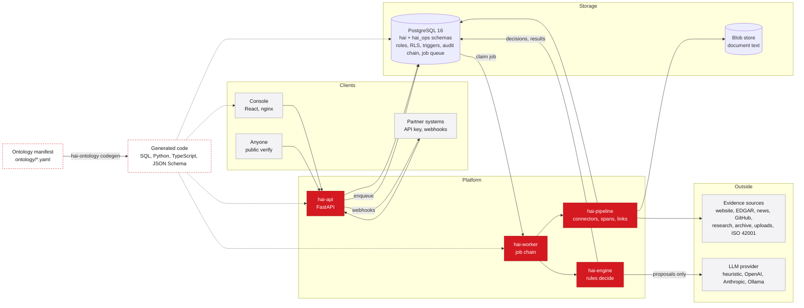
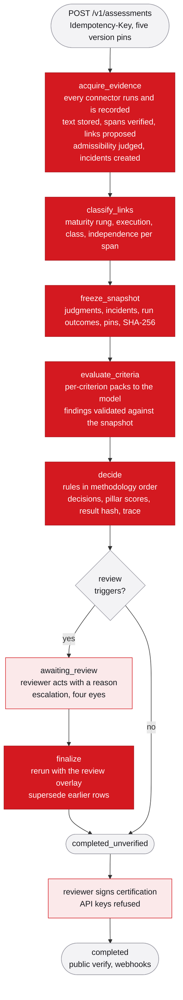
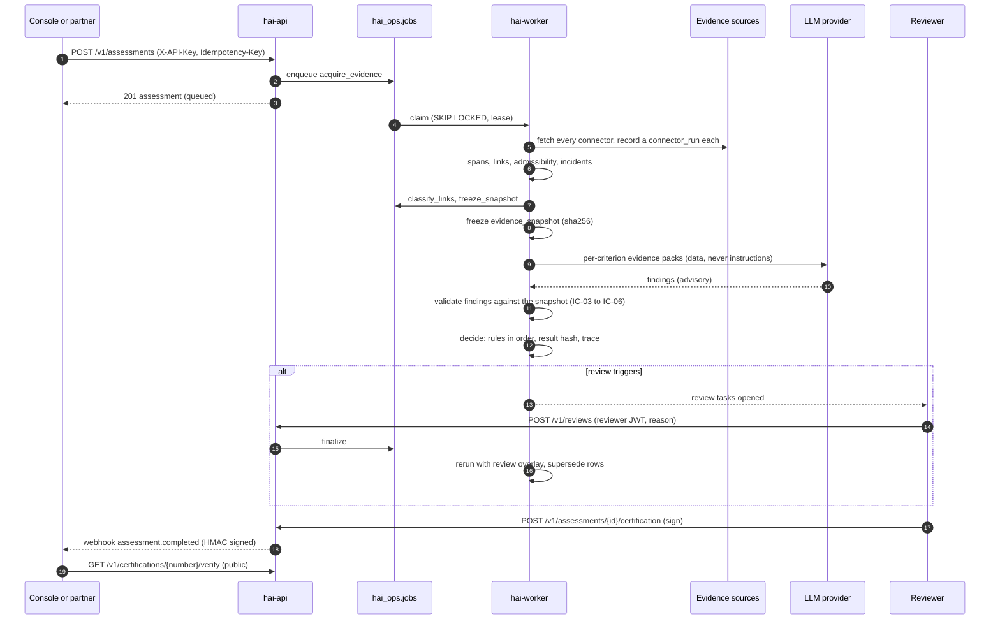
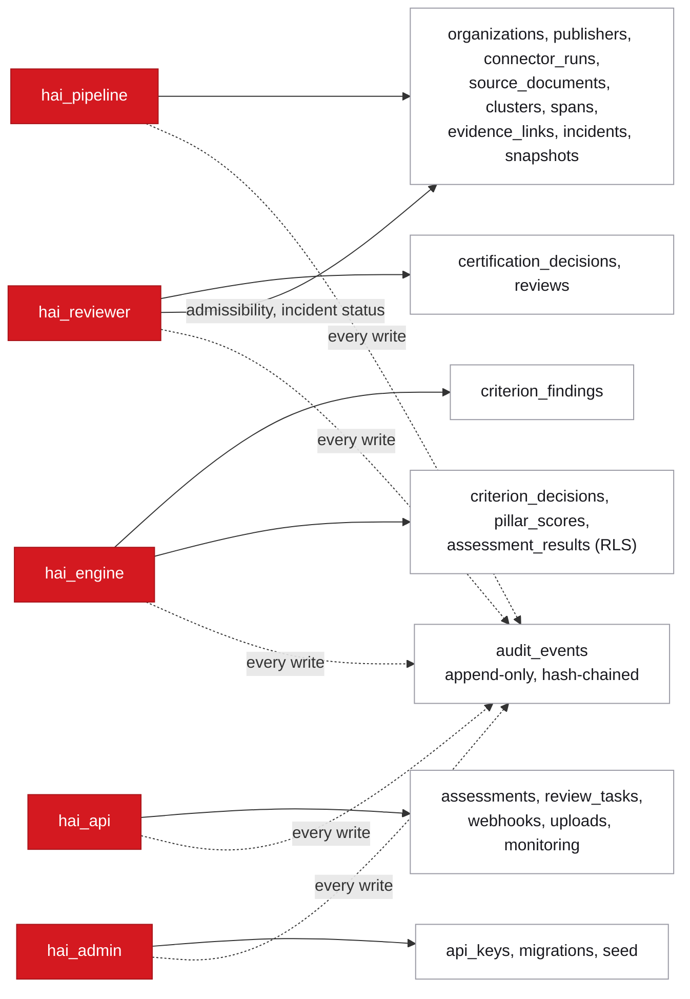

# Architecture

How the HAI Score platform is put together, what each component may write,
and where every integrity constraint is enforced. Read with
`docs/ontology-guide.md` (the manifest) and `docs/porting-from-phase6.md`
(what changed from the Node service).

## One Sentence

Public and submitted evidence about an organization is fetched by recorded
connector runs, cut into spans that match the stored text, linked to exactly
one criterion each, frozen into a snapshot, proposed on by a model, decided by
a pure rules engine that reads only the snapshot, and signed by a named
reviewer; every step is auditable and replayable.

## System Diagram

## Components

| Component | Package | Database role | Writes |
|---|---|---|---|
| Ontology tooling | `packages/hai-ontology` | none | generated files only |
| Core platform | `packages/hai-core` | all (library) | settings, typed store, audit chain, job queue, blob store, auth, reviews, webhooks, monitoring |
| Evidence pipeline | `packages/hai-pipeline` | `hai_pipeline` | organizations, publishers, connector runs, source documents, clusters, spans, links, incidents, snapshots |
| Engine | `packages/hai-engine` | `hai_engine` | findings, decisions, pillar scores, results, reports (read) |
| API | `services/api` | `hai_api`, `hai_reviewer` | assessments, reviews, certification decisions (reviewer), API keys (admin), webhooks, uploads |
| Worker | `services/worker` | per job | runs the job chain and webhooks under the role of each step |
| Console | `frontend/` | none | nothing; renders stored values |

Dependencies point one way: hai-ontology, then hai-core, then hai-pipeline and
hai-engine, then the services. The console talks only to the API.

## Data Layers

The manifest defines 30 entities in four layers (see `ontology/ontology.yaml`).

* Subject: Organization, OrganizationRelation, AISystem, Claim, Control,
  TestOutcome, Incident, Remediation.
* Evidence: Publisher, Connector, ConnectorRun, SourceDocument, SourceCluster,
  EvidenceSpan, EvidenceLink.
* Methodology: MethodologyVersion, Pillar, Criterion, LevelDescriptor,
  CriterionApplicability, Rule.
* Assessment: Assessment, EvidenceSnapshot, CriterionFinding,
  CriterionDecision, PillarScore, AssessmentResult, CertificationDecision,
  Review, AuditEvent.

Operational tables that are not part of the ontology live in the `hai_ops`
schema (`db/migrations/0002_operations.sql`): jobs, API keys, webhook
subscriptions and deliveries, review tasks, monitoring subscriptions, uploads,
and two read views (`v_latest_results`, `v_industry_benchmarks`).

## How An Assessment Runs

1. `POST /v1/assessments` (API key, `Idempotency-Key` header). The API resolves
   or creates the organization, records the assessment with its five version
   pins (ontology, methodology, ruleset, prompt, model; IC-18), and enqueues
   `acquire_evidence`.
2. `acquire_evidence` (role `hai_pipeline`). Entity resolution verifies
   identifiers only when registries agree with the submitted domain. Every
   connector in `config/connectors.yaml` runs and records a `connector_run`
   with an outcome, even when it returns nothing or is blocked (AT-01). Fetched
   text goes to the blob store; `source_documents` point at it. Text is cut into
   spans with character offsets that are verified against the stored text.
   Lexicon matches propose links; admissibility is assessed in a fixed order
   (irrelevant, untrusted such as prompt injection, unverifiable, stale);
   negative signals create one incident per canonical event key (IC-10) in
   `alleged` status unless the publisher is a regulator (IC-11).
3. `classify_links`. Maturity rung, execution level, evidence class and
   independence are set per span from descriptors, never from the source tier.
4. `freeze_snapshot`. The judgment columns of every link, incident states,
   connector run outcomes and version pins are copied into an
   `evidence_snapshot` with a SHA-256. From here on the engine reads only this.
5. `evaluate_criteria` (role `hai_engine`). Per-criterion evidence packs are
   built from full documents (omissions counted, AT-09) and sent to the
   provider with crawled text as data, never as instructions (IC-17). Findings
   are validated against the JSON Schema and the snapshot (IC-03 to IC-06);
   rejected findings are stored for audit and never used.
6. `decide`. The rules engine runs every rule in methodology order for each
   criterion and then for the assessment, writes `criterion_decisions` with
   applied rule codes and a trace, aggregates pillar scores, applies caps and
   gates, and writes the `assessment_result` with its hash. Review triggers open
   review tasks and move the assessment to `awaiting_review` when needed.
7. Reviews. A reviewer acts on tasks with a reason; escalation hands the task
   to a different reviewer; the requester of a certification cannot sign it
   (AT-14). `finalize` reruns the engine with the review overlay and supersedes
   the earlier rows.
8. Certification. A reviewer JWT signs; an API key is refused. `hai_certified`
   cannot be stored without a signed decision (IC-13). Verification is public.
9. Webhooks deliver `assessment.completed` and related events with an HMAC
   signature. Monitoring subscriptions trigger reassessments on a cadence.

## Integrity Constraint Enforcement

Generated from `ontology/ontology.yaml` (`integrity_constraints`). The
acceptance test column names the AT whose tests prove the constraint; the AT
table below maps each AT to test functions.

| IC | Rule | Enforced in | Where | Acceptance test |
|---|---|---|---|---|
| IC-01 | evidence_links.polarity cannot be updated after insert. | db_trigger | db/migrations/0001_ontology_baseline.sql (generated triggers) and db/migrations/0002_operations.sql; generated trg_evidence_links_immutable (polarity, span_id, target_type, target_id, criterion_code) | AT-06 |
| IC-02 | source_documents, evidence_spans, criterion_decisions, audit_events are insert-only. | db_trigger | db/migrations/0001_ontology_baseline.sql (generated triggers) and db/migrations/0002_operations.sql; generated trg_<table>_append_only on every append_only and immutable entity | AT-13 |
| IC-03 | An evidence span's quote must match the stored snapshot at its character offsets. | validator | packages/hai-engine/src/hai_engine/validation.py; hai_pipeline.spans.verify_span and hai_engine.validation.check_quotes | AT-03 |
| IC-04 | A criterion finding may cite only span and link ids inside its assessment's evidence snapshot. | validator | packages/hai-engine/src/hai_engine/validation.py; hai_engine.validation.check_citations | AT-08 |
| IC-05 | A finding with a missing or unknown criterion_code, or no citations for a proposed level above 1, is rejected. | validator | packages/hai-engine/src/hai_engine/validation.py; hai_engine.validation.check_schema | AT-08 |
| IC-06 | maturity_rung above stated_commitment requires a span with non-empty quoted text, not metadata only. | validator | packages/hai-engine/src/hai_engine/validation.py; generated CK-SPAN-QUOTE plus hai_engine.classification and hai_engine.validation.check_maturity_credit | AT-03 |
| IC-07 | maturity_rung independently_verified requires independence independent or regulator. | db_check | db/migrations/0001_ontology_baseline.sql (generated CHECK constraints); generated CHECK IC-07 on evidence_links and the EvidenceLink Pydantic validator | AT-12 |
| IC-08 | A link contributes only to the criterion_code it names. No cross-criterion or global promotion. | rules_engine | packages/hai-engine/src/hai_engine/rules/builtin.py and decision.py; hai_engine.rules.context.CriterionContext | AT-02 |
| IC-09 | Documents in one source cluster count once for independence and confidence. | rules_engine | packages/hai-engine/src/hai_engine/rules/builtin.py and decision.py; hai_engine.rules.builtin.conf_evidence (CONF-EVIDENCE) | AT-07 |
| IC-10 | One canonical incident per canonical_event_key; at most one score adjustment per incident per assessment. | db_unique | db/migrations/0001_ontology_baseline.sql (generated UNIQUE constraints); generated UNIQUE incidents.canonical_event_key plus hai_engine.rules.builtin.adj_incidents (ADJ-INCIDENTS) | AT-04 |
| IC-11 | Incidents in alleged or under_investigation create a review, never an automatic adjustment. | rules_engine | packages/hai-engine/src/hai_engine/rules/builtin.py and decision.py; hai_engine.rules.builtin.gate_unverified_incidents (GATE-UNVERIFIED-INCIDENTS) | AT-05 |
| IC-12 | criterion_decisions, assessment_results and certification_decisions are writable only by the rules-engine and reviewer roles. | db_grants | db/migrations/0001_ontology_baseline.sql (roles and grants), 0002 RLS policies; generated GRANTs from entities[].writers, RLS policies in db/migrations/0002, SET LOCAL ROLE in hai_core.db | AT-10 |
| IC-13 | hai_certified requires a signed certification_decisions row with a reviewer. | db_trigger | db/migrations/0001_ontology_baseline.sql (generated triggers) and db/migrations/0002_operations.sql; db/migrations/0002 trg_results_require_certification (constraint trigger) plus GATE-OUTCOME-STATUS | AT-10 |
| IC-14 | Every criterion_decision lists at least one applied rule code. | db_check | db/migrations/0001_ontology_baseline.sql (generated CHECK constraints); generated CHECK IC-14 on criterion_decisions | AT-12 |
| IC-15 | coverage_state unavailable requires at least one failed or blocked connector_run. | rules_engine | packages/hai-engine/src/hai_engine/rules/builtin.py and decision.py; hai_engine.rules.builtin.gate_coverage (GATE-COVERAGE) | AT-11 |
| IC-16 | No source may be reported as collected unless a connector_run with succeeded exists for it. | report_generator | packages/hai-engine/src/hai_engine/reporting.py; hai_engine.reporting.collected_sources | AT-11 |
| IC-17 | Crawled text is stored as data only and never concatenated into system instructions. | evaluation_worker | packages/hai-engine/src/hai_engine/packs.py and llm/prompts.py; hai_engine.llm.prompts.build_messages | AT-15 |
| IC-18 | Each assessment pins ontology, methodology, ruleset, prompt and model versions; none may be null. | db_not_null | db/migrations/0001_ontology_baseline.sql (NOT NULL columns); generated NOT NULL on assessments.ontology_version, methodology_version, ruleset_version, prompt_version, model_id | AT-07 |

## Acceptance Tests To Test Functions

A unit test (`tests/test_acceptance_tests_are_mapped.py`) fails when any test
named in the manifest does not exist.

| AT | Title | Tests (file) |
|---|---|---|
| AT-01 | Every source runs on every assessment | `test_every_connector_runs_and_is_recorded` (tests/integration/test_pipeline_acquire.py); `test_full_assessment_lifecycle` (tests/e2e/test_full_flow.py) |
| AT-02 | No global execution leakage | `test_execution_is_per_span` (packages/hai-engine/tests/test_evaluation.py); `test_link_counts_only_for_its_criterion` (packages/hai-engine/tests/test_rules.py) |
| AT-03 | Metadata is not evidence | `test_metadata_is_not_evidence` (packages/hai-engine/tests/test_evaluation.py); `test_quote_offsets_and_quotes` (packages/hai-engine/tests/test_evaluation.py); `test_spans_have_exact_offsets` (packages/hai-pipeline/tests/test_pipeline_units.py) |
| AT-04 | One incident per event | `test_event_keys_bucket_by_month` (packages/hai-pipeline/tests/test_pipeline_units.py); `test_one_incident_from_two_articles` (packages/hai-pipeline/tests/test_pipeline_units.py) |
| AT-05 | Alleged incidents go to review | `test_alleged_incident_has_no_automatic_effect` (packages/hai-engine/tests/test_rules.py); `test_incidents_start_conservative` (packages/hai-pipeline/tests/test_pipeline_units.py) |
| AT-06 | Polarity is never overwritten | `test_polarity_is_immutable` (tests/integration/test_core_platform.py) |
| AT-07 | Replay is deterministic | `test_replay_matches_stored_result` (packages/hai-engine/tests/test_rules.py); `test_a_source_cluster_counts_once` (packages/hai-engine/tests/test_rules.py); `test_version_pins_are_mandatory` (tests/integration/test_core_platform.py) |
| AT-08 | Findings cite only the snapshot | `test_bad_findings_are_rejected` (packages/hai-engine/tests/test_evaluation.py); `test_citation_outside_the_snapshot` (packages/hai-engine/tests/test_evaluation.py); `test_a_good_finding_passes` (packages/hai-engine/tests/test_evaluation.py) |
| AT-09 | Evidence is not truncated | `test_evidence_pack_is_per_criterion_and_counts_omissions` (packages/hai-engine/tests/test_evaluation.py) |
| AT-10 | One authority for scores and status | `test_result_tables_are_writable_only_by_engine_role` (tests/integration/test_core_platform.py); `test_api_keys_cannot_sign` (services/api/tests/test_api.py); `test_hai_certified_requires_signed_decision` (tests/integration/test_core_platform.py) |
| AT-11 | Unavailable is not missing | `test_unavailable_only_when_a_connector_failed` (packages/hai-engine/tests/test_rules.py); `test_blocked_sources_are_unavailable_not_missing` (tests/e2e/test_full_flow.py); `test_report_lists_only_collected_sources` (tests/integration/test_engine_decide.py) |
| AT-12 | One manifest everywhere | `test_independence_comes_from_the_publisher_not_the_tier` (packages/hai-pipeline/tests/test_pipeline_units.py); `test_generated_files_are_up_to_date` (packages/hai-ontology/tests/test_manifest.py); `test_no_hand_typed_codes_outside_generated_files` (tests/test_codes_not_hand_typed.py) |
| AT-13 | Complete append-only ledger | `test_append_only_tables_refuse_updates` (tests/integration/test_core_platform.py); `test_news_items_carry_real_dates_and_publishers` (packages/hai-pipeline/tests/test_connectors.py) |
| AT-14 | Review workflow | `test_escalation_and_four_eyes` (tests/integration/test_core_platform.py); `test_review_requires_reason` (services/api/tests/test_api.py) |
| AT-15 | Tamper evidence and prompt isolation | `test_audit_tampering_is_detected` (tests/integration/test_core_platform.py); `test_every_write_is_audited_and_the_chain_verifies` (tests/integration/test_core_platform.py); `test_injection_never_reaches_the_model` (packages/hai-engine/tests/test_evaluation.py) |

## Authority And Authorization

* Principals: API key (`X-API-Key`, scopes from `hai_ops.api_keys`), reviewer
  or admin JWT (`Authorization: Bearer`, HS256, minted by an admin at
  `POST /v1/auth/token`), anonymous (health, ready, verify, ontology).
* Scopes gate routes; the database role gates writes. Both are needed to
  change decision-bearing rows.
* Every write through the typed store is audited; decision-bearing entities
  require a reason.

## Versioning And Reproducibility

Each assessment pins five versions. Replay loads the snapshot and the manifest
at the pinned versions, reruns the engine and compares the result hash. The
manifest is semver versioned; `hai-ontology diff` classifies changes and
`check-bump` refuses an under-bumped release. Docker images carry the ontology
and methodology versions as labels and copy the manifest and migrations in, so
one image is one ontology version.

## Operations

* `docker-compose.yml`: postgres, migrate (wait, migrate, seed, validate), api,
  worker, frontend; `--profile ollama` adds a local model server.
* Health: `/health` (process), `/ready` (database migrated to this manifest
  hash). The console proxies `/v1` to `API_UPSTREAM`.
* Logs are JSON with request ids. The audit chain is verified with
  `hai-db verify-audit`.
* Secrets: four signing secrets, all refused in production when they start with
  `dev-` or are shorter than 32 characters.

## Known Gaps

* The certification signature has no key id; rotating the signing key requires
  re-signing (ADR 0012).
* The second-opinion provider path is exercised against mocked HTTP only.
* The remote LLM providers (OpenAI, Anthropic, Ollama) are tested against
  `httpx.MockTransport`, not live services.
* Methodology content (definitions, level descriptors, weights for T2 versus
  T3, the crosswalk) is draft until Humaital approves it; see `docs/plan.md`
  section 6.
