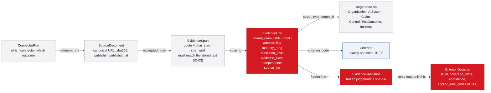
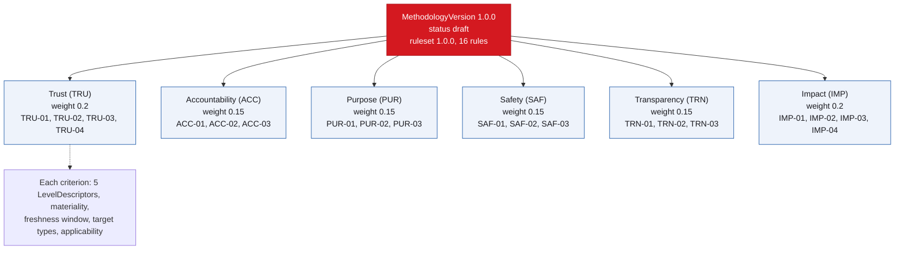
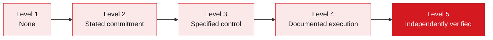
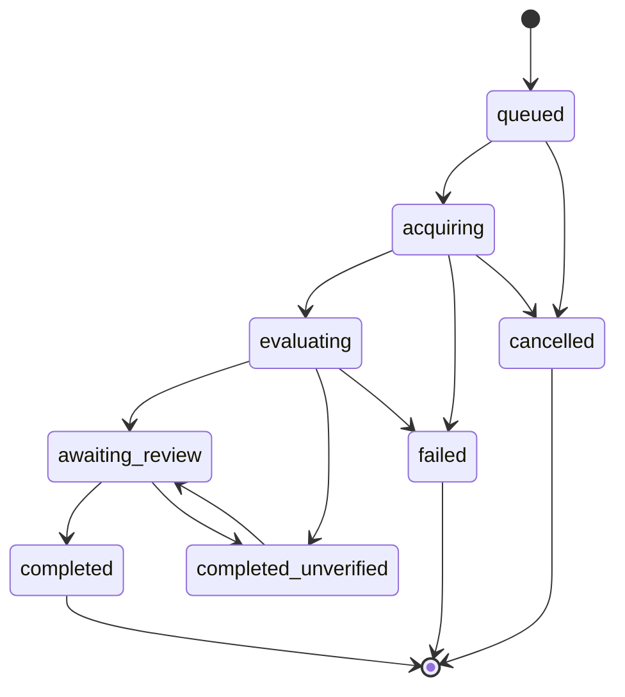

# The HAI Ontology

This directory is the source of truth for the HAI Score platform. Everything
the platform knows about organizations, evidence, the methodology and
assessments is defined here in YAML and generated from here into SQL, Python,
TypeScript, JSON Schema and documentation. Nothing in the generated files is
edited by hand.

Current versions: ontology `1.0.0`, methodology
`1.0.0` (status `draft`), ruleset `1.0.0`.

## Contents

1. [Files](#files)
2. [The Four Layers](#the-four-layers)
3. [Entity Relationships](#entity-relationships)
4. [The Evidence Link, The Only Bridge To A Score](#the-evidence-link-the-only-bridge-to-a-score)
5. [The Methodology](#the-methodology)
6. [The Maturity Ladder](#the-maturity-ladder)
7. [Assessment Lifecycle](#assessment-lifecycle)
8. [Entities](#entities)
9. [Relation Catalogue](#relation-catalogue)
10. [Vocabularies](#vocabularies)
11. [Rules](#rules)
12. [Integrity Constraints](#integrity-constraints)
13. [What Is Generated](#what-is-generated)
14. [Changing The Ontology](#changing-the-ontology)
15. [Draft Content](#draft-content)

## Files

| Path | Contents |
|---|---|
| `ontology.yaml` | header, the four layers, database roles, 30 entities with fields, the relation catalogue (33 relations), integrity constraints IC-01 to IC-18, acceptance tests AT-01 to AT-15 |
| `vocabularies/*.yaml` | 34 closed vocabularies, one per file, with labels, descriptions, optional attributes and state transitions |
| `methodology/methodology.yaml` | scoring, confidence, certification, outcome, freshness, review triggers, lexicons |
| `methodology/pillars.yaml` | the six pillars and their weights |
| `methodology/criteria/<CODE>.yaml` | one file per criterion: definition, materiality, freshness window, target types, applicability, five level descriptors |
| `methodology/rules.yaml` | the ruleset: 16 rules with kind, scope, run order and parameters |
| `methodology/decisions.yaml` | open decisions D1 to D10 with the current behaviour |
| `methodology/crosswalks.yaml` | draft mapping to the EU AI Act, NIST AI RMF and ISO/IEC 42001 (not part of scoring) |
| `examples/valid/`, `examples/invalid/` | sample records checked by the validator and CI |
| `CHANGELOG.md` | every change to the manifest, with the semver reasoning |

Two vocabularies, `criterion_code` and `pillar_code`, are derived from the
methodology files at load time and never written by hand.

## The Four Layers

| Layer | Question it answers | Entities |
|---|---|---|
| Subject | What is being rated? | Organization, OrganizationRelation, AISystem, Claim, Control, TestOutcome, Incident, Remediation |
| Evidence | What do we know, and from where? | Publisher, Connector, ConnectorRun, SourceDocument, SourceCluster, EvidenceSpan, EvidenceLink |
| Methodology | How is it judged? | MethodologyVersion, Pillar, Criterion, LevelDescriptor, CriterionApplicability, Rule |
| Assessment | What was decided, by what, and who signed? | Assessment, EvidenceSnapshot, CriterionFinding, CriterionDecision, PillarScore, AssessmentResult, CertificationDecision, Review, AuditEvent |

The subject layer is mostly mutable (organizations change). The evidence and
assessment layers are mostly append-only: corrections add a row that
`supersedes` the old one, so history is never edited.

## Entity Relationships

Generated from the relation catalogue in `ontology.yaml`. Arrows carry the
relation name; the `supersedes` self-relations are left out for legibility.
The red node with the thick border is the evidence link, the only path from
evidence to a score. Grey is the subject layer, light red the evidence layer,
blue the methodology layer and solid red the assessment layer.

```mermaid
flowchart TB
    classDef subject fill:#f3f3f5,stroke:#9a9aa4,color:#1a1a1f
    classDef evidence fill:#fbe9ea,stroke:#D41920,color:#1a1a1f
    classDef methodology fill:#eef3fb,stroke:#1e5aa8,color:#1a1a1f
    classDef assessment fill:#D41920,stroke:#A8141A,color:#ffffff
    classDef bridge fill:#D41920,stroke:#1a1a1f,stroke-width:3px,color:#ffffff
    subgraph subject["Subject layer"]
        Organization["Organization"]
        OrganizationRelation["OrganizationRelation"]
        AISystem["AISystem"]
        Claim["Claim"]
        Control["Control"]
        TestOutcome["TestOutcome"]
        Incident["Incident"]
        Remediation["Remediation"]
    end
    subgraph evidence["Evidence layer"]
        Publisher["Publisher"]
        Connector["Connector"]
        ConnectorRun["ConnectorRun"]
        SourceDocument["SourceDocument"]
        SourceCluster["SourceCluster"]
        EvidenceSpan["EvidenceSpan"]
        EvidenceLink["EvidenceLink"]
    end
    subgraph methodology["Methodology layer"]
        MethodologyVersion["MethodologyVersion"]
        Pillar["Pillar"]
        Criterion["Criterion"]
        LevelDescriptor["LevelDescriptor"]
        CriterionApplicability["CriterionApplicability"]
        Rule["Rule"]
    end
    subgraph assessment["Assessment layer"]
        Assessment["Assessment"]
        EvidenceSnapshot["EvidenceSnapshot"]
        CriterionFinding["CriterionFinding"]
        CriterionDecision["CriterionDecision"]
        PillarScore["PillarScore"]
        AssessmentResult["AssessmentResult"]
        CertificationDecision["CertificationDecision"]
        Review["Review"]
        AuditEvent["AuditEvent"]
    end
    Organization -- operates --> AISystem
    Organization -- controls_entity --> Organization
    Organization -- protected_by --> Control
    Organization -- protected_by --> AISystem
    Organization -- asserts --> Claim
    Claim -- describes --> Control
    Claim -- describes --> Incident
    Claim -- describes --> AISystem
    Claim -- describes --> Organization
    Control -- evaluated_by --> TestOutcome
    Incident -- affected --> AISystem
    Incident -- affected --> Control
    Incident -- incident_of --> Organization
    Remediation -- remediates --> Incident
    TestOutcome -- verified_by --> Organization
    TestOutcome -- assessed_by --> Organization
    SourceDocument -- published_by --> Publisher
    Publisher -- publisher_is --> Organization
    SourceDocument -- retrieved_via --> ConnectorRun
    ConnectorRun -- run_for --> Assessment
    ConnectorRun -- run_of --> Connector
    SourceDocument -- member_of --> SourceCluster
    Claim -- uploaded_as --> SourceDocument
    EvidenceSpan -- excerpted_from --> SourceDocument
    EvidenceSpan -- bears_on --> Organization
    EvidenceSpan -- bears_on --> AISystem
    EvidenceSpan -- bears_on --> Claim
    EvidenceSpan -- bears_on --> Control
    EvidenceSpan -- bears_on --> TestOutcome
    EvidenceSpan -- bears_on --> Incident
    Pillar -- part_of_methodology --> MethodologyVersion
    Criterion -- belongs_to --> Pillar
    LevelDescriptor -- defined_by --> Criterion
    CriterionApplicability -- applicable_to --> Criterion
    Assessment -- assesses --> Organization
    Assessment -- reassesses --> Assessment
    Assessment -- pins --> EvidenceSnapshot
    CriterionFinding -- proposed_for --> Assessment
    CriterionDecision -- derived_from --> CriterionFinding
    CriterionDecision -- contributes_to --> PillarScore
    CriterionDecision -- contributes_to --> AssessmentResult
    CertificationDecision -- certifies --> AssessmentResult
    CertificationDecision -- certifies --> Assessment
    Review -- reviewed_in --> Incident
    Review -- reviewed_in --> EvidenceLink
    Review -- reviewed_in --> CriterionFinding
    Review -- reviewed_in --> CriterionDecision
    Review -- reviewed_in --> CertificationDecision
    Review -- reviewed_in --> Assessment
    class Organization,OrganizationRelation,AISystem,Claim,Control,TestOutcome,Incident,Remediation subject
    class Publisher,Connector,ConnectorRun,SourceDocument,SourceCluster,EvidenceSpan evidence
    class MethodologyVersion,Pillar,Criterion,LevelDescriptor,CriterionApplicability,Rule methodology
    class Assessment,EvidenceSnapshot,CriterionFinding,CriterionDecision,PillarScore,AssessmentResult,CertificationDecision,Review,AuditEvent assessment
    class EvidenceLink bridge
```



## The Evidence Link, The Only Bridge To A Score

An `EvidenceLink` names exactly one quoted span, one target and one criterion,
and carries the six judgments that the rules read. Nothing else reaches a
score: not a page title, not a keyword count, not a web archive snapshot, not
the model's opinion.



| Judgment | Vocabulary | Meaning |
|---|---|---|
| polarity | `polarity` | supports, contradicts or neutral. Immutable after insert (IC-01). |
| admissibility | `admissibility` | admissible, pending review, or inadmissible (irrelevant, stale, unverifiable, untrusted). Only admissible links count. |
| maturity_rung | `maturity_rung` | how far up the ladder the span itself gets the criterion; metadata alone never lifts it above none (IC-06). |
| execution_level | `execution_level` | none, asserted, partial or verified: whether the span shows the control operating. Judged per span (AT-02). |
| evidence_class | `evidence_class` | foundational governance, core governance, operational evidence or external validation. |
| independence | `independence` | self, affiliate, commissioned, independent or regulator, from the publisher, never from the tier. `independently_verified` requires independent or regulator (IC-07). |
| source_tier | `source_tier` | T1 to T4, a weight on confidence. |

## The Methodology



Pillar weights come from the Phase 6 scoring code and are recorded in
`pillars.yaml`. Criterion codes are `PIL-NN`; the Phase 6 snake_case ids are
kept as `legacy_id` aliases. Each criterion carries a materiality
(`standard` or `high`), a freshness window, the target types it may be
evidenced on, optional applicability conditions, and five level descriptors.

## The Maturity Ladder

Each level of a criterion requires a maturity rung. The default ladder is the
same for every criterion (decision D1 allows a per-criterion override):



The rules cap a criterion at the highest rung its admissible, supporting
evidence reaches. A model proposal above that cap is lowered, never the other
way round.

## Assessment Lifecycle

States and transitions come from the `lifecycle_state` vocabulary and are
enforced by a generated database trigger.



## Entities

| Entity | Table | Layer | Mutability | Writers | What it is |
|---|---|---|---|---|---|
| Organization | `organizations` | Subject | mutable | hai_pipeline, hai_api, hai_admin | The rated organization. External identifiers are stored only when verified against the submitted domain. |
| OrganizationRelation | `organization_relations` | Subject | mutable | hai_pipeline, hai_api, hai_admin | Parent, subsidiary, affiliate or acquisition links between organizations. Drives independence. |
| AISystem | `ai_systems` | Subject | mutable | hai_pipeline, hai_api, hai_admin | An AI system operated by the organization. Optional in v1 (decision D6); evidence may link to the organization directly. |
| Claim | `claims` | Subject | append_only | hai_pipeline, hai_api | An assertion the organization makes about itself. A claim is never evidence of its own truth. Uploads enter as claims. |
| Control | `controls` | Subject | mutable | hai_pipeline, hai_api | A governance mechanism protecting a system or the organization. |
| TestOutcome | `test_outcomes` | Subject | append_only | hai_pipeline, hai_api | A point-in-time test of a control. A failed test is kept and shown, never dropped. |
| Incident | `incidents` | Subject | mutable | hai_pipeline, hai_reviewer, hai_api | One row per real-world event regardless of article count. News reports attach as evidence (AT-04). |
| Remediation | `remediations` | Subject | mutable | hai_pipeline, hai_reviewer, hai_api | An action taken to fix an incident. Closure counts as independently verified only with an independent verifier. |
| Publisher | `publishers` | Evidence | mutable | hai_pipeline, hai_admin | Who published a source document. org_id is set when the publisher is the rated organization or an affiliate. |
| Connector | `connectors` | Evidence | mutable | hai_admin | A configured evidence source. A new source is a configuration row, not an ontology change. |
| ConnectorRun | `connector_runs` | Evidence | mutable | hai_pipeline | Proof that a fetch was attempted for an assessment and how it ended (IC-16). Recorded even when nothing came back. |
| SourceDocument | `source_documents` | Evidence | append_only | hai_pipeline, hai_api | A frozen copy of a fetched or uploaded document with its hash, dates and rights. A re-fetch with a different hash is a new row. |
| SourceCluster | `source_clusters` | Evidence | mutable | hai_pipeline | Groups syndicated or near-duplicate documents so they count once for independence and confidence (IC-09). |
| EvidenceSpan | `evidence_spans` | Evidence | append_only | hai_pipeline | The citable unit. The exact quote with character offsets into the stored text (IC-03). |
| EvidenceLink | `evidence_links` | Evidence | mutable | hai_pipeline, hai_engine, hai_reviewer | The only bridge from evidence to a score. One span, one target, one criterion, six separate judgments (spec section 6). |
| MethodologyVersion | `methodology_versions` | Methodology | mutable | hai_admin | A released methodology. Only a signed Humaital change record creates a new version. |
| Pillar | `pillars` | Methodology | mutable | hai_admin | One of the six pillars. |
| Criterion | `criteria` | Methodology | mutable | hai_admin | One of the twenty criteria. Codes are permanent; retired codes are never reused. |
| LevelDescriptor | `level_descriptors` | Methodology | mutable | hai_admin | What each level 1 to 5 means for one criterion, and the maturity rung it requires (decision D1). |
| CriterionApplicability | `criterion_applicability` | Methodology | mutable | hai_admin | When a criterion does not apply or must be reviewed (decision D5). |
| Rule | `rules` | Methodology | mutable | hai_admin | One rule of a ruleset, referenced by code so traces can name it. |
| Assessment | `assessments` | Assessment | mutable | hai_api, hai_pipeline, hai_engine, hai_reviewer | One scoring run. Pins every version (IC-18). lifecycle_state follows spec section 8.1. |
| EvidenceSnapshot | `evidence_snapshots` | Assessment | immutable | hai_pipeline | Frozen copy of every link's judgment columns, incident states and version pins. The rules engine reads only this (AT-07). |
| CriterionFinding | `criterion_findings` | Assessment | append_only | hai_engine | LLM or heuristic output. Advisory only. Rejected findings are stored for audit and never used (IC-05). |
| CriterionDecision | `criterion_decisions` | Assessment | append_only | hai_engine | Rules-engine output. The only source of criterion levels. Every decision lists the rules that ran (IC-14). |
| PillarScore | `pillar_scores` | Assessment | append_only | hai_engine | Derived per pillar; never edited. |
| AssessmentResult | `assessment_results` | Assessment | append_only | hai_engine | The HAI Score, confidence and effectiveness plus the outcome status set only by the rules engine (AT-10). |
| CertificationDecision | `certification_decisions` | Assessment | append_only | hai_reviewer | Signed by a named reviewer. Never written by the LLM, the engine or the browser (IC-13). |
| Review | `reviews` | Assessment | append_only | hai_reviewer | A human decision on an incident, contradiction, borderline confidence, finding, link, appeal or certification. Always with a reason. |
| AuditEvent | `audit_events` | Assessment | immutable | hai_pipeline, hai_engine, hai_reviewer, hai_api, hai_admin | Append-only, hash-chained record of every decision-bearing write (AT-15). |

## Relation Catalogue

| Relation | From | To | Cardinality | Time-bound | Notes |
|---|---|---|---|---|---|
| `operates` | Organization | AISystem | one to many | yes | System ownership can transfer. |
| `controls_entity` | Organization | Organization via OrganizationRelation | many to many | yes | Subsidiary, affiliate or acquisition. Drives independence. |
| `protected_by` | Organization | Control, AISystem | many to many | yes | A control may cover several systems. |
| `asserts` | Organization | Claim | one to many | no | The organization is the claimant. |
| `describes` | Claim | Control, Incident, AISystem, Organization | many to one | no | What the claim is about. |
| `evaluated_by` | Control | TestOutcome | one to many | no | Tests are point-in-time. |
| `affected` | Incident | AISystem, Control | many to many | no | Which systems and controls the event touched. |
| `incident_of` | Incident | Organization | many to one | no | The organization an incident concerns. |
| `remediates` | Remediation | Incident | many to one | no | Remediation of an incident. |
| `verified_by` | TestOutcome | Organization | many to one | no | Verifier must be independent to count as verified. |
| `assessed_by` | TestOutcome | Organization | many to one | no | Who performed the test. |
| `published_by` | SourceDocument | Publisher | many to one | no | Publisher of the document. |
| `publisher_is` | Publisher | Organization | many to one | no | The organization behind a publisher. |
| `retrieved_via` | SourceDocument | ConnectorRun | many to one | no | Proves the source was actually fetched (IC-16). |
| `run_for` | ConnectorRun | Assessment | many to one | no | The assessment a run served. |
| `run_of` | ConnectorRun | Connector | many to one | no | The connector that ran. |
| `member_of` | SourceDocument | SourceCluster | many to one | no | Syndication and duplicates. |
| `uploaded_as` | Claim | SourceDocument | many to one | no | Uploaded evidence enters as a claim. |
| `excerpted_from` | EvidenceSpan | SourceDocument | many to one | no | The document a span is cut from. |
| `bears_on` | EvidenceSpan | Organization, AISystem, Claim, Control, TestOutcome, Incident via EvidenceLink | many to many | yes | Supports, contradicts or neutral, stored as polarity on the link, scoped to one criterion. |
| `supersedes` | SourceDocument | SourceDocument | one to one | no | Corrections and re-fetches add a row that supersedes the old one. |
| `part_of_methodology` | Pillar | MethodologyVersion | many to one | no | Fixed per methodology version. |
| `belongs_to` | Criterion | Pillar | many to one | no | Fixed per methodology version. |
| `defined_by` | LevelDescriptor | Criterion | many to one | no | Exactly five per criterion. |
| `applicable_to` | CriterionApplicability | Criterion | many to one | no | Applicability conditions of a criterion. |
| `assesses` | Assessment | Organization | many to one | no | The rated organization. |
| `reassesses` | Assessment | Assessment | many to one | no | A new assessment under a new methodology or on request; history is never edited. |
| `pins` | Assessment | EvidenceSnapshot | one to one | no | Reproducibility. |
| `proposed_for` | CriterionFinding | Assessment | many to one | no | Findings of an assessment. |
| `derived_from` | CriterionDecision | CriterionFinding | many to one | no | The scoring trace; rules are named in applied_rule_codes. |
| `contributes_to` | CriterionDecision | PillarScore, AssessmentResult | many to one | no | Aggregation path to the HAI Score, keyed by assessment. |
| `certifies` | CertificationDecision | AssessmentResult, Assessment | many to one | no | A reviewer certifies a result. |
| `reviewed_in` | Review | Incident, EvidenceLink, CriterionFinding, CriterionDecision, CertificationDecision, Assessment | many to one | no | Any reviewable row. |

## Vocabularies

Every vocabulary is closed: the database CHECK constraints, the Python enums,
the TypeScript unions and the LLM output schema are all generated from these
files, so an unknown value is refused everywhere at once.

| Vocabulary | Values | Attributes | Purpose |
|---|---|---|---|
| `admissibility` | 6 | usable | Whether a link may be used in scoring at all. Checked in a fixed order: untrusted, unverifiable, irrelevant, stale. Changed only via review. |
| `applicability_effect` | 2 |  | What happens when an applicability condition holds (decision D5). |
| `certification_outcome` | 3 |  | A reviewer's certification decision. |
| `claim_scope_type` | 4 |  | What a claim is about. |
| `cluster_method` | 3 |  | How a source cluster was formed. |
| `connector_run_outcome` | 5 | counts_as_unavailable, succeeded | How a connector run ended (spec 4.2). counts_as_unavailable says whether the run lets a criterion be unavailable (IC-15). |
| `connector_status` | 3 |  | Configuration state of a connector. |
| `content_status` | 2 |  | Whether methodology text is Humaital's canonical content or a draft. |
| `control_operational_status` | 6 |  | Lifecycle of a control. |
| `coverage_state` | 7 | counts_in_score, report_wording, routes_to_review | The state of a criterion decision. Absence is a state, not a score. counts_in_score says whether the criterion enters the HAI Score; report_wording is what the report must say. |
| `criticality` | 4 |  | Potential harm if an AI system fails. |
| `evidence_class` | 4 | multiplier, content_status | Kind of evidence (spec 7.8, decision D9). multiplier is the Phase 6 evidence type multiplier (legacy evidence-weighting.js:122-126); foundational_governance shares the governance value as a draft. |
| `execution_level` | 4 | bonus | Per-span proof of execution (Phase 6 FIX-12, legacy proof-of-execution.js:28-33). bonus is the confidence bonus (legacy :279-287). |
| `finding_validation_status` | 2 |  | Whether the validator accepted a finding. |
| `incident_severity` | 4 | legacy_tier, level_effect, confidence_ceiling | Four-level severity (decision D4), mapped from the Phase 6 override tiers (legacy negative-signal-overrides.js:40-45). level_effect is the level reduction applied by ADJ-INCIDENTS to the most material criterion once the incident is substantiated; confidence_ceiling caps that criterion's confidence. |
| `incident_status` | 6 | can_adjust_score | Verification status of an incident. Only substantiated or later can produce an automatic score effect; alleged and under_investigation route to review (IC-11). transitions lists legal moves; dismissed is reachable from any open state. |
| `independence` | 5 |  | Who stands behind the statement relative to the rated organization. Derived from the publisher and organization relations, never from the source tier. |
| `lifecycle_state` | 8 | terminal | Where the assessment job is (spec 8.1). Separate from outcome status. Transitions are enforced by a database trigger. |
| `materiality` | 2 |  | Consequence class of a criterion (decision D2). The numeric weight lives on the criterion. |
| `maturity_rung` | 5 | credit | How far along the ladder a span proves the target. Set by the classifier from the quote and the publisher only; a title, label or date alone stays at none. credit is the share of the confidence contribution the rung earns (Phase 6 justifies 1.0 and supports 0.5). |
| `methodology_status` | 3 |  | Approval state of a methodology version. |
| `org_relation_type` | 3 |  | Kind of control between organizations. |
| `outcome_status` | 6 |  | What the result means (spec 8.2). Set only by the rules engine, evaluated top to bottom by rank; the first match wins. Rendered exactly as stored (AT-10). |
| `polarity` | 3 |  | Whether a span supports, contradicts or merely mentions the target on one criterion. Set once by the proposer and checked by the validator; never updated (IC-01). |
| `publisher_type` | 9 | source_tier, default_independence | Kind of publisher (spec 7.9). source_tier is looked up from here; it is potential authority only and never sets maturity or independence. default_independence is the starting independence before organization relations are applied. |
| `review_action` | 6 | keeps_task_open | What a reviewer decided. keeps_task_open says whether the task stays in the queue for another reviewer. |
| `review_subject_type` | 8 | allowed_actions | What a review is about. allowed_actions is the contract the console enforces. |
| `rule_kind` | 4 |  | What a rule does. |
| `rule_scope` | 2 |  | Whether a rule runs per criterion or once per assessment. |
| `size_band` | 4 | max_headcount | Organization size by headcount (spec 7.10 placeholders; decision D3). aliases carry the Phase 6 form inputs (legacy evaluate.js:77, report-generator.js:905-913). |
| `source_tier` | 4 | weight, legacy_tier | How authoritative a kind of source could be. weight is the Phase 6 tier weight (legacy supplementary-evidence.js:97-108: high 1.0, medium 0.6, low 0.25); the T2 and T3 split is a draft (decision D9). |
| `stage_band` | 3 |  | Organization stage (spec 7.10 placeholders; decision D3). aliases carry the Phase 6 form inputs (legacy evaluate.js:76, report-generator.js:899-901). |
| `target_type` | 6 | entity | What an evidence link is about. The AI system level is optional in v1 (decision D6). |
| `test_result` | 3 |  | Outcome of a control test. |

## Rules

Rules run in `run_order`, criterion-scoped rules first for every criterion,
then assessment-scoped rules once. Each rule is a pure function registered in
`hai_engine.rules` under the same code; the validator refuses a manifest whose
rules have no implementation and an implementation whose rule is not in the
manifest.

| Order | Rule | Kind | Scope | Description |
|---|---|---|---|---|
| 10 | `GATE-APPLICABILITY` | gate | criterion | Evaluate the criterion's applicability conditions. not_applicable excludes the criterion; review routes it. |
| 20 | `GATE-COVERAGE` | gate | criterion | Set coverage state. unavailable only when a connector run failed or was blocked and no admissible support exists (IC-15); otherwise missing, observed, not_tested, failed or contradictory. |
| 30 | `ADJ-START-FROM-FINDING` | adjustment | criterion | Start the level from the accepted finding's proposed level, or from the evidence ladder when no finding was accepted. Findings are advisory. |
| 40 | `CAP-NO-ADMISSIBLE-SUPPORT` | cap | criterion | Without any admissible supporting link the level is the missing level. |
| 50 | `CAP-MATURITY` | cap | criterion | Cap the level at the highest level whose required maturity rung is reached by an admissible supporting link (decision D1). Source tier never sets maturity. |
| 60 | `CAP-FAILED-EXECUTION` | cap | criterion | A failed test outcome caps the level at the specified_control level. |
| 70 | `GATE-UNVERIFIED-INCIDENTS` | gate | criterion | Alleged or under-investigation incidents targeting this criterion route it to review with no automatic effect (IC-11). |
| 80 | `ADJ-INCIDENTS` | adjustment | criterion | Apply each substantiated incident's severity effect once, on its most material criterion only (IC-10). |
| 90 | `CONF-EVIDENCE` | confidence | criterion | Confidence from admissible supporting links: tier x class x rung credit x materiality x freshness decay x base, clusters counted once (IC-09), plus corroboration, execution and omission terms. |
| 100 | `CONF-CONTRADICTION` | confidence | criterion | Admissible contradicting links lower confidence and, with admissible support, make the criterion contradictory. |
| 110 | `CONF-INCIDENT-CEILING` | confidence | criterion | A substantiated incident's confidence ceiling caps the confidence of its most material criterion. |
| 200 | `CAP-SCORE-CEILING` | cap | assessment | The HAI Score never exceeds scoring.score_cap. |
| 210 | `CAP-SCORE-LOW-CONFIDENCE` | cap | assessment | When overall confidence is below the threshold the score is capped. |
| 220 | `GATE-REVIEW-TRIGGERS` | gate | assessment | Collect review triggers: contradictory criteria, unverified incidents, borderline confidence, certification request, second-opinion disagreement. |
| 230 | `GATE-CERTIFICATION` | gate | assessment | Compare the score and confidence with the threshold in force (decision D3) and record gate reasons. |
| 240 | `GATE-OUTCOME-STATUS` | gate | assessment | Set outcome status, first match wins: access_limited, insufficient_evidence, governance_baseline, confidence_too_low, certification_not_yet_achieved, hai_certified (only with a signed decision). |

## Integrity Constraints

Where each constraint is enforced and which test proves it is tabulated in
`docs/architecture.md`.

| IC | Rule | Enforced in |
|---|---|---|
| IC-01 | evidence_links.polarity cannot be updated after insert. | db_trigger |
| IC-02 | source_documents, evidence_spans, criterion_decisions, audit_events are insert-only. | db_trigger |
| IC-03 | An evidence span's quote must match the stored snapshot at its character offsets. | validator |
| IC-04 | A criterion finding may cite only span and link ids inside its assessment's evidence snapshot. | validator |
| IC-05 | A finding with a missing or unknown criterion_code, or no citations for a proposed level above 1, is rejected. | validator |
| IC-06 | maturity_rung above stated_commitment requires a span with non-empty quoted text, not metadata only. | validator |
| IC-07 | maturity_rung independently_verified requires independence independent or regulator. | db_check |
| IC-08 | A link contributes only to the criterion_code it names. No cross-criterion or global promotion. | rules_engine |
| IC-09 | Documents in one source cluster count once for independence and confidence. | rules_engine |
| IC-10 | One canonical incident per canonical_event_key; at most one score adjustment per incident per assessment. | db_unique |
| IC-11 | Incidents in alleged or under_investigation create a review, never an automatic adjustment. | rules_engine |
| IC-12 | criterion_decisions, assessment_results and certification_decisions are writable only by the rules-engine and reviewer roles. | db_grants |
| IC-13 | hai_certified requires a signed certification_decisions row with a reviewer. | db_trigger |
| IC-14 | Every criterion_decision lists at least one applied rule code. | db_check |
| IC-15 | coverage_state unavailable requires at least one failed or blocked connector_run. | rules_engine |
| IC-16 | No source may be reported as collected unless a connector_run with succeeded exists for it. | report_generator |
| IC-17 | Crawled text is stored as data only and never concatenated into system instructions. | evaluation_worker |
| IC-18 | Each assessment pins ontology, methodology, ruleset, prompt and model versions; none may be null. | db_not_null |

## What Is Generated

| Output | Path | Consumer |
|---|---|---|
| Baseline SQL | `db/migrations/0001_ontology_baseline.sql` | PostgreSQL: tables, enums, roles, grants, triggers, RLS |
| Python enums, models, tables | `packages/hai-core/src/hai_core/generated/` | every Python package |
| LLM output schemas | `packages/hai-engine/src/hai_engine/generated/` | finding and proposal validation |
| TypeScript module | `frontend/src/generated/ontology.ts` | the console |
| Labels, glossary, JSON-LD | `docs/generated/` | docs and integrations |

Each generated file carries the manifest SHA-256. Services compare it at
startup and refuse to run on drift; `hai-ontology codegen --check` fails CI.

## Changing The Ontology

```bash
make ontology-validate     # meta-model, references, examples, rule implementations
make codegen               # regenerate everything above
make check-bump            # has the semver moved far enough against origin/main?
make migrate-plan          # additive SQL for the change
```

Then record the change in `CHANGELOG.md`. Adding a vocabulary value or an
optional field is a minor bump; removing or renaming anything is major.
Methodology content changes need Humaital sign-off before `status` becomes
`approved`.

## Draft Content

Everything marked `content_status: draft` with `TODO(humaital)` is a
placeholder: all 20 criterion definitions, all 100 level
descriptors, indicator labels, retrieval hints beyond the legacy keyword map,
T2 versus T3 tier weights, evidence class definitions, per-criterion freshness
windows, the partial-evaluation confidence ceiling, the stage and size
certification table, and the crosswalks. The platform renders a drafts notice
in every report until Humaital approves the content.
